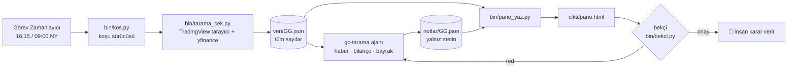

# Geri Çekilme Tarayıcısı

**ABD borsasında güçlü trenddeki hisselerin geri çekilmelerini her gün otomatik tarayan, kuralları
koda bağlı bir sinyal panosu.** Sayıları deterministik Python hesaplar, bir Claude Code ajanı haberleri
doğrular, sonuç tek bir HTML panoya düşer. Emir düğmesi her zaman insandadır.

   

---

## Problem

Takip ettiğim strateji basit: **güçlü bir hisse kısa süre düştüğünde, düşüş biterken girmek.**
Ama bunu elle uygulamak mümkün değildi:

- Evren her gün değişiyor. Filtreye uyan 60 civarı hisse var ve her biri için grafiği açıp
  RSI'ı, bantları, trendi, bilanço tarihini kontrol etmek her akşam saatler alıyordu.
- Sinyal kapanmış güne bakıyor. Yani kontrolü ABD borsası kapandıktan sonra yapmak gerekiyor; bu
  da Türkiye saatiyle gece yarısına denk geliyor. Bir akşam atlanınca sinyal kaçıyordu.
- Elle taramada kurallar esniyor. "Stop biraz geniş ama olsun" ya da "haberi iyi, girerim" gibi
  kararlar tutarlılığı bozuyordu.
- Stop seviyesi, pozisyon adedi ve toplam risk gibi hesapları her seferinde elle yapmak hata riskini
  artırıyordu.

**Kısacası bütün hisseleri her gün elle tarayamıyordum. Bu sistemi bu yüzden kurdum.**

## Çözüm

Taramayı, hesapları ve kural uygulamasını bir programa devrettim. Kararı ve emri kendimde tuttum.

- **Günde iki kez kendiliğinden tarar:** borsa kapandıktan sonra (gün sonu) ve ertesi gün borsa
  açılmadan önce (bkz. [Ne zaman tarar](#ne-zaman-tarar)).
- **Bütün sayıları kod hesaplar.** RSI, Bollinger, ATR, stop, R, adet ve risk tavanları Python'da
  deterministik olarak hesaplanır ve JSON'a yazılır. Yapay zekâ hiçbir sayı üretmez.
- **Ajan yalnızca yorum yapar.** Adayların son haberlerini araştırır, bilanço tarihini doğrular,
  "kırmızı bayrak" (dava, rehberlik düşürme, sulandırma vb.) arar. Bunlar kuralı değiştirmez,
  panoya not olarak düşer.
- **Bekçi her koşuyu denetler.** Panodaki her sayı o günün veri dosyasında birebir bulunmuyorsa,
  ya da piyasa rejimi kırmızıyken bir aday "uygun" görünüyorsa koşu reddedilir ve düzeltilir.
- **Sonuç tek bir sayfadır.** `pano.html` her zaman en güncel taramayı gösterir. Telefonda da okunur.

---

## Kullanılan kombinasyon (Strateji v3)

> **Stratejinin kaynağı:** fikri *FİNANS VE BORSA* kanalının
> [“Yükseliş Trendine Giren Hisseleri En Erken Bulan Trade Stratejisi”](https://www.youtube.com/watch?v=3BhZCbNxs5A)
> videosundan aldım. Bu projede yaptığım, o yaklaşımı ölçülebilir kurallara çevirmek, geri testle
> sınamak ve taramasını otomatikleştirmek oldu.

Kuralların tamamı [`sirket/STRATEJI-v3.md`](sirket/STRATEJI-v3.md) dosyasındadır. Ajan bu dosyayı
değiştiremez. Kural değişirse yeni bir sürüm dosyası açılır.

### 1. Evren: hangi hisseler taranır

TradingView tarayıcı filtreleri, günde yaklaşık 55 ila 70 hisse:

| Filtre | Koşul |
|---|---|
| Piyasa | ABD: S&P 500, Nasdaq 100, Dow Jones, Nasdaq Composite, Russell 2000 |
| Piyasa değeri | > 2 milyar $ |
| Analist notu | "Al" veya "Güçlü al" |
| 1 yıllık performans | > %30 |
| Günlük trend | Fiyat > EMA100 ve Fiyat > EMA200 |
| Haftalık trend | Fiyat > EMA50 ve Fiyat > EMA21 |
| Hacim | 90 günlük ort. hacim > 10 günlük ort. hacim |
| Oynaklık | ADR > %3,5 |

### 2. Giriş sinyali: RSI Bollinger dönüşü

RSI'ın kendisine Bollinger bandı uygulanır:

```
rsi   = RSI(kapanış, 14)            # Wilder, TradingView ta.rsi ile aynı
orta  = SMA(rsi, 14)
alt   = orta − 2 × stdev(rsi, 14)   # popülasyon stdev, TradingView ta.stdev ile aynı
mesafe = rsi − alt
```

- **Bölgede:** dünkü kapanışta `mesafe ≤ 2` (RSI alt banda değmiş ya da altına geçmiş).
- **Dönüş:** dün RSI dip yaptı, bugün yukarı döndü.
- **Tip:** son 5 barda RSI bandın altına geçtiyse `ALTINA_GEÇTİ`, geçmediyse `DOKUNDU`. İki tip
  ayrı gösterilir ve ayrı ölçülür.

### 3. Eleme: sinyal var ama işleme uygun mu?

| Filtre | Kural |
|---|---|
| Piyasa rejimi | SPY < SMA200 ise rejim KIRMIZI olur ve o gün hiçbir aday uygun sayılmaz |
| Trend (v3) | Fiyat > EMA200 **ve** EMA50 > EMA200 olmalı. Fiyat > EMA100 ise "GÜÇLÜ TREND" |
| Bilanço | Bilançoya 5 işlem gününden az kaldıysa elenir |
| Stop genişliği | Stop girişin %8'inden uzaksa elenir |
| Günlük sınır | En fazla 3 uygun aday seçilir (stop % en küçük olanlar), kalanlar "yedek" olur |
| Portföy tavanı | En fazla 5 açık pozisyon ve en fazla %5 toplam açık risk |

### 4. Seviyeler ve risk

```
giriş referansı = sinyal günü kapanışı   (gerçek giriş ertesi gün açılışta, elle)
stop            = giriş − 1,5 × ATR(14)  (yalnız yukarı taşınır)
R               = giriş − stop
adet            = ⌊ (portföy × %1) ÷ R ⌋
2R seviyesi     = giriş + 2R             (bilgi amaçlı)
```

### 5. Çıkış

Hangisi önce gelirse: **stop** · **RSI orta bandın üstüne çıkar (asıl hedef)** · **15 işlem günü
doldu** · **bilançodan önceki son işlem günü**.

---

## Ne zaman tarar

Pazartesi ile cuma arası günde iki kez çalışır. Saatler **New York saatine** bağlıdır, bu yüzden yaz ve kış
saati geçişinde elle ayar gerekmez. Zamanlayıcı Windows Görev Zamanlayıcısı'dır (`bin/zamanla.py`).

| Koşu | New York | TSİ (yaz / kış) | Ne yapar |
|---|---|---|---|
| **Gün sonu (kapanış)** | 16:15 | 23:15 / 00:15 | Kapanmış günlük barla bütün evreni tarar, sinyalleri hesaplar, yarının aday listesini ve açık pozisyonların çıkış kontrolünü yazar |
| **Açılış öncesi** | 09:00 | 16:00 / 17:00 | Yeni sinyal hesaplamaz. Önceki akşamın adaylarına premarket fiyatı ve gece haberleriyle tekrar bakar: stop altında açılış "GAP, girilmez", 2R üstünde açılış "kaçtı, kovalanmaz" |
| Haftalık günlük | Pazartesi 09:30 TSİ | | Kapanmış işlemlerden istatistik çıkarır ve geri testle kıyaslar |

Gün içinde tarama yapılmaz. Sinyal kapanmış bara göre tanımlı. Yarım barda RSI sürekli değişir ve
sinyal görünüp kaybolur. ABD tatil günlerinde betik "YENİ BAR YOK" der ve koşu erken biter.

---

## Nasıl çalışır



**Temel ilke: sayıyı kod hesaplar, ajan yorumlar.** Ajan veri JSON'unu ve panoyu elle düzenleyemez.
Panodaki bütün sayıları `pano_yaz.py` veri dosyasından olduğu gibi basar.

### Pano

`takimlar/gc-tarama/cikti/pano.html`. Tek dosyadır, dış bağımlılığı yoktur ve koyu temalıdır.

1. **Üst şerit:** tarih, strateji sürümü, SPY/QQQ rejim çipleri, evren ve sinyal sayısı, açık risk
2. **Açık pozisyonlar:** çıkış koşulu oluşanlar en üstte, sebebiyle birlikte
3. **İşleme uygun adaylar (en fazla 3):** sinyal tipi, giriş, stop, R, adet, 2R, bilanço tarihi,
   etiketli haber notu ve TradingView grafik bağlantısı
4. **Yedekler ve elenenler:** her biri eleme sebebiyle

Hiç sinyal olmayan günlerde panoda "Bugün kurala uyan aday yok." yazar.

---

## Geri test: dürüst tablo

Beş yıllık geri test (`bin/geri_test.py`, `bin/geri_deney.py`) canlı taramayla **aynı hesap
fonksiyonlarını** kullanır, kod kopyalanmaz. Komisyon sonrası net beklenti:

| Evren | İşlem | Kazanma | Beklenti (R, net) | `ALTINA_GEÇTİ` | `DOKUNDU` |
|---|---|---|---|---|---|
| Bugünkü güçlü hisseler (2021–2026) | 709 | %56,0 | **+0,046** | +0,075 | +0,002 |
| O günkü evren (her gün filtreyi geçenler) | 1711 | %55,9 | **−0,003** | −0,010 | +0,005 |

**Okuma:** bugünkü evrenin sonucu hayatta kalma yanlılığı yüzünden olduğundan iyi görünüyor. Yanlılığı
azaltan "o günkü evren" testinde beklenti sıfıra yakın çıkıyor. Bu yüzden strateji **kâğıt işlem
dönemindedir.** Gerçek para ancak 8 haftalık kâğıt işlem pozitif sonuç verirse ve benim kararımla
kullanılır. Raporlar [`geri-test/`](geri-test/) klasöründe, sürüm kararları
[`kasa/decisions/`](kasa/decisions/) klasöründe.

---

## Kurulum

**Gereksinimler:** Windows 10/11, Python 3.10+, giriş yapılmış [Claude Code](https://docs.claude.com/en/docs/claude-code) CLI.

```powershell
git clone https://github.com/bugra123uysal/geri-cekilme-tarayicisi.git
cd geri-cekilme-tarayicisi
python -m pip install --user -r requirements.txt
copy .env.example .env      # isteğe bağlı anahtarlar; .env git'e girmez
```

Portföy büyüklüğü, komisyon ve evren eşikleri tek yerde durur: [`bin/ayar.py`](bin/ayar.py).

## Kullanım

```powershell
# Veriyi elle çek (LLM çağırmaz)
python bin/tarama_cek.py --kapanis        # gün sonu taraması
python bin/tarama_cek.py --acilis         # açılış öncesi kontrol
python bin/pano_yaz.py                    # panoyu yeniden üret

# Ajanlı tam koşu
python bin/kos.py gc-tarama --gorev kapanis
python bin/kos.py gc-tarama --kuru        # hiçbir şeye dokunmadan prova

# Zamanlayıcı (Windows Görev Zamanlayıcı)
python bin/zamanla.py --goster            # NY → TSİ tetik tablosu
python bin/zamanla.py --kur | --durum | --kaldir

# Geri test ve günlük
python bin/geri_test.py --yil 5
python bin/geri_deney.py --yil 5
python bin/gunluk_hesap.py

# Testler
python -m pytest -q
```

Açık pozisyonlar `pozisyonlar.csv` dosyasından, kapanmış işlemler `islemler.csv` dosyasından okunur.
İkisi de kişisel veridir ve repoya girmez.

## Klasör yapısı

```
bin/                    tarama_cek.py · pano_yaz.py · gc_hesap.py (ortak hesap modülü)
                        geri_test.py · geri_deney.py · gunluk_hesap.py
                        kos.py (koşu sürücüsü) · bekci.py (denetçi) · zamanla.py · ayar.py
sirket/STRATEJI-v*.md   strateji sürümleri: değişmez, yenisi açılır
takimlar/gc-tarama/     tarama takımı: takim.md · kurallar.md · defter.md · cikti/ (pano)
takimlar/gc-gunluk/     haftalık işlem günlüğü takımı
geri-test/              geri test raporları
kasa/                   Obsidian hafızası: strateji kararları, haftalık özetler, kavramlar
tests/                  birim testleri (RSI/Bollinger TradingView değerleriyle doğrulanır)
ANAYASA.md              değişmez çerçeve: emir insanda, kaynaksız sayı yok, risk tavanları
```

## Güvenlik ilkeleri

- **Emir düğmesi insanındır.** Hiçbir bileşen aracı kuruma bağlanmaz, emir göndermez,
  TradingView'da alarm ya da çizim oluşturmaz.
- **Kaynaksız sayı yoktur.** Panodaki her sayı veri dosyasında birebir bulunur ve bekçi bunu denetler.
- **Strateji sürümlüdür.** Ajan kuralı esnetemez. Önerisini yalnızca `defter.md` dosyasına yazabilir.
- **Anahtarlar** yalnızca süreç ortamından okunur. `.env` dosyası git'e girmez.

## Sorumluluk reddi

Bu proje kişisel bir kural uygulayıcısıdır, **yatırım tavsiyesi değildir.** Geri test sonuçları
gelecekteki getiriyi garanti etmez. Gerçek parayla işlem yapmadan önce kendi araştırmanızı yapın.

## Teşekkür ve lisans

Strateji fikri: [FİNANS VE BORSA, “Yükseliş Trendine Giren Hisseleri En Erken Bulan Trade Stratejisi”](https://www.youtube.com/watch?v=3BhZCbNxs5A).
Ajan iskeleti (koşu sürücüsü, bekçi, takım yapısı)
[selmakcby/a-sirketi](https://github.com/selmakcby/a-sirketi) üzerine kuruldu ve tek bir strateji için
yeniden yazıldı. [MIT](LICENSE) lisanslıdır.
